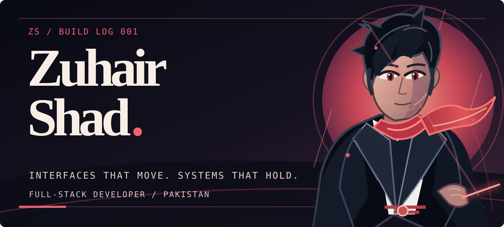
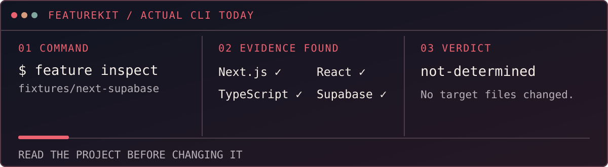
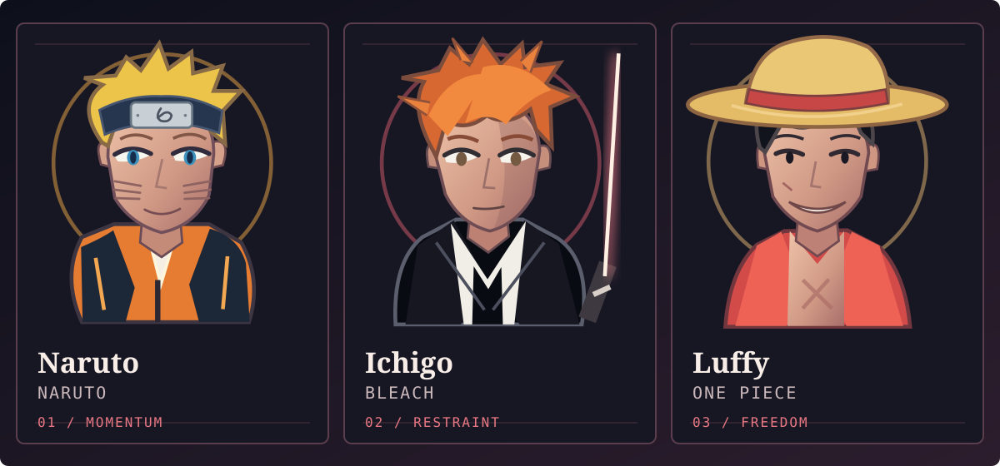
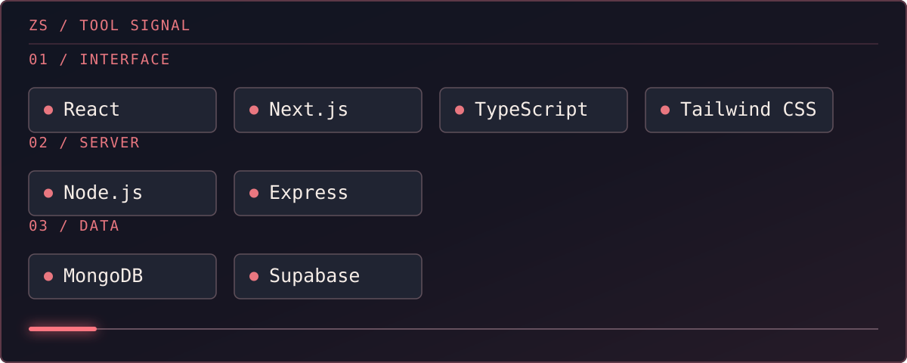

<!-- Original, self-contained SVG character art. Motion is optional; the first frame is complete. -->
<picture>
  <source media="(max-width: 600px)" srcset="./assets/hero-anime-mobile.svg" />
  
</picture>

<p align="center">
  <a href="#featurekit">FeatureKit</a> &nbsp;•&nbsp;
  <a href="#anime-frames">Anime frames</a> &nbsp;•&nbsp;
  <a href="#the-stack">The stack</a> &nbsp;•&nbsp;
  <a href="#activity">Activity</a> &nbsp;•&nbsp;
  <a href="#connect">Connect</a>
</p>

## The short version

I’m **Zuhair Shad**, a full-stack developer based in Pakistan. I build the screens people see and the systems they rely on after the first click: the API, the data model, the permissions, and the awkward states between “started” and “done.”

I’m drawn to products that have a strong point of view *and* a real workflow underneath. A polished surface gets someone to pause. Clear state, safe boundaries, and useful feedback get them to stay.

<a id="featurekit"></a>
## Currently building / FeatureKit

**The idea:** add a meaningful feature to an existing app without treating that app like an empty starter template. [FeatureKit](https://github.com/Zuhairshad/Featuristic) is a CLI I’m developing around that idea. Its first supported-host target is a Next.js App Router project using React, TypeScript, and Supabase. The first feature under active design is a Data Import Center.

**What works today:** a read-only `feature inspect` command and feature-manifest validation. The inspector looks for concrete evidence in package declarations, configuration, and bounded source files. It reports unknowns instead of turning a dependency name into a compatibility claim. I ran it against the repository’s Next.js + Supabase fixture for the sequence below.

<a href="https://github.com/Zuhairshad/Featuristic"><picture>
  <source media="(max-width: 600px)" srcset="./assets/featurekit-sequence-mobile.svg" />
  
</picture></a>

**What comes next:** feature installation is still in development. The eventual installer has to earn the right to change a project: understand its stack, explain the proposed edits, and leave a clear way to review them. The visual above shows the **current inspector**, not a working install flow.

```text
existing app
    │
    ▼
feature inspect
    ├── evidence → report it
    └── unknowns → stop guessing

feature install → in development
```

Explore the [CLI source](https://github.com/Zuhairshad/Featuristic/blob/main/apps/cli/src/inspect.ts) and the [Import Center manifest](https://github.com/Zuhairshad/Featuristic/blob/main/features/import-center/feature.json).

The current CLI output is deliberately less dramatic than the art. This is an excerpt from `feature inspect fixtures/next-supabase` in the FeatureKit repository:

```json
{
  "schemaVersion": "0.1",
  "supportAssessment": "not-determined",
  "errors": []
}
```

The full result records evidence and unknowns for Next.js, React, TypeScript, and Supabase. An empty `errors` list says the inspection completed; it does **not** claim that installing a feature is safe yet. That distinction is the point of the tool.

### The part after inspection

The installation workflow I’m aiming for has four checkpoints. This is a design target, **not a claim that the installer already does it**:

```text
╭─ 01 / READ ─────────────────────╮
│ routes · auth · data · style     │
╰──────────────┬──────────────────╯
               ↓
╭─ 02 / PLAN ─────────────────────╮
│ proposed files and reasons      │
╰──────────────┬──────────────────╯
               ↓
╭─ 03 / WRITE ────────────────────╮
│ follow the host's conventions   │
╰──────────────┬──────────────────╯
               ↓
╭─ 04 / VERIFY ───────────────────╮
│ test and report the unknowns    │
╰─────────────────────────────────╯
```

That order matters. A CLI can write files quickly; deciding **which files belong in somebody else’s app** is the harder engineering problem. For a team invitation, for example, the screen is only one piece. The feature also needs an invitation state, a way to accept or reject, authorization at the boundary, and useful failure messages. FeatureKit is where I’m working through how to make those pieces fit the host project instead of arriving as a disconnected demo.

<a id="anime-frames"></a>
## Anime frames / the pause before movement

Naruto, Ichigo, and Luffy are three characters I keep coming back to: persistence, restraint, and the instinct to move forward. I drew these as **native SVG fan art** for this README. The silhouettes, linework, and motion are vector paths, so the artwork stays sharp on a phone and the still frame is complete before animation starts.

<picture>
  <source media="(max-width: 600px)" srcset="./assets/anime-trio-mobile.svg" />
  
</picture>

The same idea guides how I build interfaces: give the important thing room, let contrast carry the focus, and make motion mean something. In code, that usually means a smaller number of strong states and a clear next action.

<a id="the-stack"></a>
## The stack / where I work

<picture>
  <source media="(max-width: 600px)" srcset="./assets/stack-signal-mobile.svg" />
  
</picture>

**Interface:** React, Next.js, TypeScript, Tailwind CSS. I care about the feeling of a screen, but also its loading, empty, error, and narrow-width states.

**Server:** Node.js and Express. I like APIs with clear inputs, predictable errors, and behavior that can be tested without a browser.

**Data:** MongoDB and Supabase. I think about schemas, access boundaries, and what can go wrong when a workflow crosses more than one service.

The through-line is the next decision a user makes. That is where an interface and its backend have to agree.

## A few working principles

- **Read before writing.** FeatureKit’s inspector stops at “not determined” when it lacks proof.
- **Make transitions explicit.** A useful flow shows what can happen next, what changed, and what failed.
- **Keep sharp edges visible.** Auth, writes, imports, and outbound actions deserve clear boundaries and reviewable behavior.
- **Let the interface explain the system.** Empty, loading, error, and narrow-screen states are part of the feature.

<a id="activity"></a>
## Commit trail / the work over time

This is a snapshot of my [public GitHub contribution calendar](https://github.com/Zuhairshad) captured on **11 November 2026**, before this profile update went live. The colors use GitHub's real activity levels, and 1,270 is the total it showed at capture time. The live calendar on my profile keeps moving; this frame keeps its moment visible.

<picture>
  <source media="(max-width: 600px)" srcset="./assets/contribution-trail-mobile.svg" />
  
</picture>

The live version takes another path: an animated snake redraws from my contribution grid each day. The [workflow](https://github.com/Zuhairshad/Zuhairshad/blob/main/.github/workflows/contribution-snake.yml) generates both themes and publishes the SVGs from this profile repository.

<picture>
  <source media="(prefers-color-scheme: dark)" srcset="https://raw.githubusercontent.com/Zuhairshad/Zuhairshad/output/contribution-snake-dark.svg" />
  <source media="(prefers-color-scheme: light)" srcset="https://raw.githubusercontent.com/Zuhairshad/Zuhairshad/output/contribution-snake-light.svg" />
  
</picture>

<a id="connect"></a>
## Send a signal

If you’re building something that needs both a distinctive interface and careful engineering, I’d like to hear about it.

<p align="center">
  <a href="mailto:zuhairshad140@gmail.com">Email</a> &nbsp;•&nbsp;
  <a href="https://www.linkedin.com/in/zuhair-ahmed1048/">LinkedIn</a> &nbsp;•&nbsp;
  <a href="https://github.com/Zuhairshad?tab=repositories">All repositories</a>
</p>

<picture>
  <source media="(max-width: 600px)" srcset="./assets/end-mark-mobile.svg" />
  
</picture>
