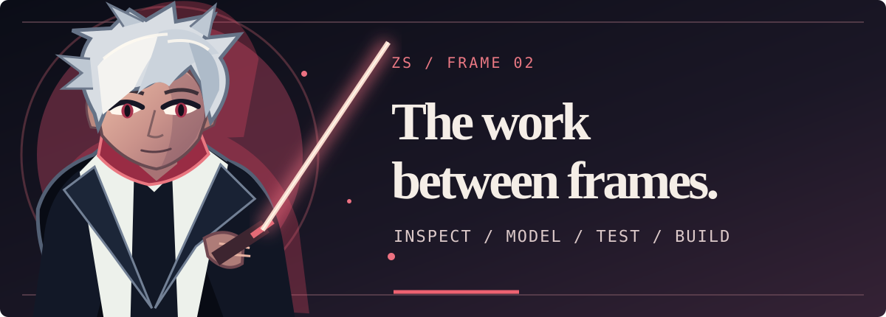
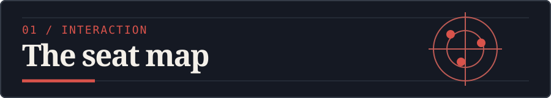
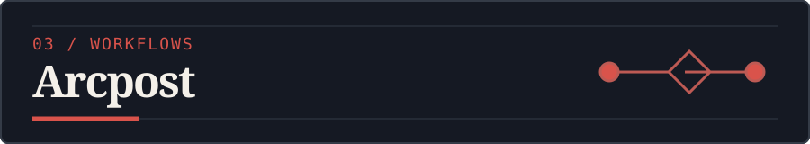

<!-- Original, self-contained SVG character art. Motion is optional; the first frame is complete. -->
<picture>
  <source media="(max-width: 600px)" srcset="./assets/hero-anime-mobile.svg" />
  
</picture>

<p align="center">
  <a href="#featurekit">FeatureKit</a> &nbsp;•&nbsp;
  <a href="#selected-work">Selected work</a> &nbsp;•&nbsp;
  <a href="#the-stack">The stack</a> &nbsp;•&nbsp;
  <a href="#activity">Activity</a> &nbsp;•&nbsp;
  <a href="#connect">Connect</a>
</p>

## The short version

I’m **Zuhair Shad**, a full-stack developer based in Pakistan. I build the screens people see and the systems they rely on after the first click: the API, the data model, the permissions, and the awkward states between “started” and “done.”

I’m drawn to products that have a strong point of view *and* a real workflow underneath. A polished surface gets someone to pause. Clear state, safe boundaries, and useful feedback get them to stay.

<a id="featurekit"></a>
## Currently building / FeatureKit

**The idea:** add a meaningful feature to an existing app without treating that app like an empty starter template. [FeatureKit](https://github.com/Zuhairshad/Featuristic) is a CLI I’m developing around that idea. Its first supported-host target is a Next.js App Router project using React, TypeScript, and Supabase. The first feature under active design is a Data Import Center.

**What works today:** a read-only `feature inspect` command and feature-manifest validation. The inspector looks for concrete evidence in package declarations, configuration, and bounded source files. It reports unknowns instead of turning a dependency name into a compatibility claim. I ran it against the repository’s Next.js + Supabase fixture for the sequence below.

<a href="https://github.com/Zuhairshad/Featuristic"><picture>
  <source media="(max-width: 600px)" srcset="./assets/featurekit-sequence-mobile.svg" />
  
</picture></a>

**What comes next:** feature installation is still in development. The eventual installer has to earn the right to change a project: understand its stack, explain the proposed edits, and leave a clear way to review them. The visual above shows the **current inspector**, not a working install flow.

```text
existing app
    │
    ▼
feature inspect
    ├── evidence → report it
    └── unknowns → stop guessing

feature install → in development
```

Explore the [CLI source](https://github.com/Zuhairshad/Featuristic/blob/main/apps/cli/src/inspect.ts) and the [Import Center manifest](https://github.com/Zuhairshad/Featuristic/blob/main/features/import-center/feature.json).

<picture>
  <source media="(max-width: 600px)" srcset="./assets/interlude-anime-mobile.svg" />
  
</picture>

The current CLI output is deliberately less dramatic than the art. This is an excerpt from `feature inspect fixtures/next-supabase` in the FeatureKit repository:

```json
{
  "schemaVersion": "0.1",
  "supportAssessment": "not-determined",
  "errors": []
}
```

The full result records evidence and unknowns for Next.js, React, TypeScript, and Supabase. An empty `errors` list says the inspection completed; it does **not** claim that installing a feature is safe yet. That distinction is the point of the tool.

<a id="selected-work"></a>
## Selected work / four different problems

### 01 — Make a huge room feel small

<a href="https://github.com/Zuhairshad/Interactive-Event-Seating-Map"></a>

**[Interactive Event Seating Map](https://github.com/Zuhairshad/Interactive-Event-Seating-Map)** is a React + SVG seat-booking project. I like the tension here: a venue is one large visual object, but rendering every seat at once can make interaction heavy. The repo documents a sector view that limits the active part of the map, along with a backend LRU cache for seat-status reads.

**Open it for:** the rendering tradeoff, the seat-selection flow, and the explicit notes on what an in-memory demo would need before production persistence and concurrency safety.

### 02 — Put the rules behind the pretty part

<a href="https://github.com/Zuhairshad/Giftpop"></a>

**[Giftpop](https://github.com/Zuhairshad/Giftpop)** brings a visual gift builder together with a customer app, a staff app, an Express API, and shared contracts. The interesting part is what happens after someone makes a beautiful gift: pricing, payment timing, packing, shipping, and the allowed changes between order states.

**Open it for:** the [integer-money quote calculation](https://github.com/Zuhairshad/Giftpop/blob/main/packages/contracts/src/pricing.ts) and the [order transition table](https://github.com/Zuhairshad/Giftpop/blob/main/packages/contracts/src/order-status.ts). Those rules are easier to reason about when they live in one place.

### 03 — Treat publishing as a guarded action

<a href="https://github.com/Zuhairshad/Repurpose-MVP"></a>

**[Arcpost](https://github.com/Zuhairshad/Repurpose-MVP)** is a content-routing workspace for creators and social teams. The public repo contains the MVP product shell, workflow contracts, connection and token-vault boundaries, and scheduling/publishing scaffolding. The detail I’d point you to is its [publish-mode gate](https://github.com/Zuhairshad/Repurpose-MVP/blob/main/packages/config/src/publish-mode.ts): disabled, sandbox, and live are explicit states, with CI forced to disabled.

**Open it for:** a workflow system that makes unsafe outbound actions difficult to trigger accidentally. Live provider publishing still needs the production checks listed in the repo.

### 04 — Verification across roles

<a href="https://github.com/Zuhairshad/EduChain-Credentials-Verification-System"></a>

**[EduChain](https://github.com/Zuhairshad/EduChain-Credentials-Verification-System)** explores academic credentials as a full-stack verification problem. Its repository separates the issuing institution’s portal, a student-facing app, a verifier app, and Solidity contracts. That separation makes the question concrete: who can issue a credential, who can present it, and what exactly does a verifier check?

**Open it for:** the multi-role product shape and the contract/application boundary.

<a id="the-stack"></a>
## The stack / where I work

<picture>
  <source media="(max-width: 600px)" srcset="./assets/stack-signal-mobile.svg" />
  
</picture>

**Interface:** React, Next.js, TypeScript, Tailwind CSS. I care about the feeling of a screen, but also its loading, empty, error, and narrow-width states.

**Server:** Node.js and Express. I like APIs with clear inputs, predictable errors, and behavior that can be tested without a browser.

**Data:** MongoDB and Supabase. I think about schemas, access boundaries, and what can go wrong when a workflow crosses more than one service.

The through-line is the next decision a user makes. That is where an interface and its backend have to agree.

## A few working principles

- **Read before writing.** FeatureKit’s inspector stops at “not determined” when it lacks proof.
- **Make transitions explicit.** Giftpop’s order status table says which move is allowed and what information it needs.
- **Keep sharp edges visible.** Arcpost’s publish modes distinguish local safety from a real outbound action.
- **Let the interface explain the system.** The seat map makes a large venue navigable one sector at a time.

<a id="activity"></a>
## Commit trail / the work over time

This is a snapshot of my [public GitHub contribution calendar](https://github.com/Zuhairshad) on **11 November 2026**. The colors use GitHub's real activity levels, and the 1,270 total is the count GitHub reported that day. The live calendar on my profile stays current; the frame below keeps this build log's date visible.

<picture>
  <source media="(max-width: 600px)" srcset="./assets/contribution-trail-mobile.svg" />
  
</picture>

<a id="connect"></a>
## Send a signal

If you’re building something that needs both a distinctive interface and careful engineering, I’d like to hear about it.

<p align="center">
  <a href="mailto:zuhairshad140@gmail.com">Email</a> &nbsp;•&nbsp;
  <a href="https://www.linkedin.com/in/zuhair-ahmed1048/">LinkedIn</a> &nbsp;•&nbsp;
  <a href="https://github.com/Zuhairshad?tab=repositories">All repositories</a>
</p>

<picture>
  <source media="(max-width: 600px)" srcset="./assets/end-mark-mobile.svg" />
  
</picture>
